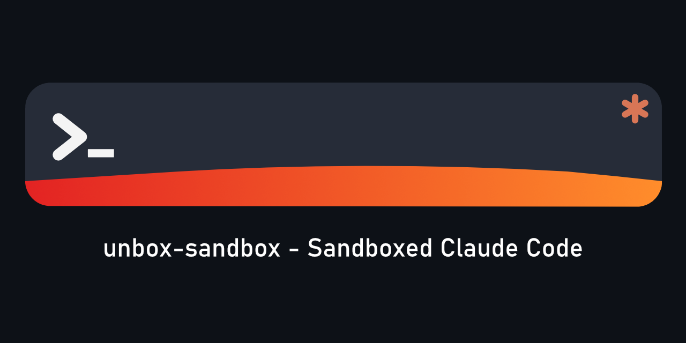

# unbox-sandbox - A Sandboxed Claude Code

A container in which Claude Code works unattended, without permission prompts, while the LAN and the Unraid server stay out of its reach. On every start, the container firewalls itself against the LAN, drops the capability to change those rules, and only then starts Claude as an unprivileged user.

The image runs on its own, from the Docker tab. Its companion is Unbox (coming soon), a plugin that creates and manages several of these sandboxes and switches host access per sandbox.

<p align="center">
  
</p>

<p align="center">
  <a href="https://github.com/kaedinger/unbox-sandbox/releases/latest"></a>
  <a href="https://github.com/kaedinger/unbox-sandbox/releases"></a>
  <br>
  <a href="https://unraid.net/"></a>
  <a href="https://forums.unraid.net/topic/201453-support-kaedinger-unbox-sandbox-claude-code-unattended/"></a>
  <a href="https://github.com/kaedinger/unbox-sandbox/issues"></a>
</p>

---

## How It Works

On every start, the entrypoint runs as root and

1. sets an egress firewall in the container's own network namespace: the internet is open; private, link-local, CGNAT and multicast ranges (`10/8`, `172.16/12`, `192.168/16`, `169.254/16`, `100.64/10`, `224/4`) are rejected, except DNS to the configured resolvers and the configured LAN exceptions; IPv6 is loopback only,
2. drops `CAP_NET_ADMIN` from the bounding set, irrevocably for every process that follows,
3. switches to the user `claude` (`PUID`/`PGID`, default 99:100) and starts Claude Code in a tmux session, in bypass mode, with Remote Control.

If the firewall can't be set, nothing starts. There's no `sudo` in the image: nothing Claude can write is ever run as root.

Claude Code itself isn't part of the image. It's installed into the home folder on the first start, with Anthropic's installer, and updates itself there.

### Inside the sandbox

| Path | Content |
|---|---|
| `/workspace` | Projects Claude works on |
| `/home/claude` | Claude Code, its login, settings, memory and conversations |
| `/backup` | Daily archives of memory, conversations and settings (no login, no keys); the last 7 are kept |

On the first start, a default rules file (`~/.claude/CLAUDE.md`) goes into the empty home: what the sandbox is, what's out of bounds, how to handle usage limits and secrets. Edits to it are kept.

### Restarts

Claude restarts on its own 30 seconds after it exits. With `SANDBOX_CONTINUE=yes` (default), it continues the last conversation after a restart (container restart, image update, reboot, crash), if there is one. A continued conversation that ends within 30 seconds is followed by a new one, so a broken conversation can't keep Claude from coming up.

### Host access

Optional, per sandbox: while switched on, Claude may `ssh host` and is root on the Unraid server, in manual mode (every action needs approval in Remote Control). Switched off, the firewall blocks the server again and Claude is back in bypass mode. Switching restarts only Claude, not the container; the conversation continues. A container restart switches host access off.

The switch is `host-access.sh`, shipped in the image but run on the host, as root. It's taken from the sandbox's image, never from the running sandbox, and nothing in it executes files from the sandbox. Unbox runs it; by hand:

```bash
C=mysandbox
docker run --rm --entrypoint cat "$(docker inspect -f '{{.Image}}' $C)" \
  /usr/local/lib/claude-sandbox/host-access.sh | bash -s -- $C key|on|off|status
```

`key` creates the sandbox's SSH key and prints the line for *Users → root → SSH authorized keys*. The script never edits `authorized_keys`.

---

## Features

- **Firewalled against the LAN** - set before anything else runs, then locked: Claude can't change it
- **No root, no sudo** - tools go to `~/.local` and persist with the home
- **LAN exceptions** - `host:port` targets the sandbox may reach anyway, e.g. a Git server
- **Remote Control** - work with Claude from claude.ai/code or the Claude app; the hostname is the session name
- **Continues after restarts** - optional, with a guard against broken conversations
- **Host access on demand** - root SSH to the server only while switched on, with prompts
- **Daily backup** - memory, conversations and settings into `/backup`, no secrets
- **Usage check** - `claude-usage` shows the 5-hour and 7-day plan usage, so long unattended work can stop cleanly
- **Tools included** - git, gh, build-essential, Python 3, PHP with composer, jq, shellcheck, curl, rsync, ssh, tmux

---

## Installation

### Via Community Applications (coming soon)

1. Install the **Community Applications** plugin
2. Search for **unbox-sandbox**
3. Click Install

For more than one sandbox, give each its own name, the same `--hostname` in *Extra Parameters* and its own folders.

### With Unbox (coming soon)

Install Unbox, choose a share, add a sandbox, click *Install Claude*. Unbox creates the container from a Docker template, so it shows up on the Docker tab like any other.

### Manual

```bash
NAME=sandbox ROOT=/mnt/user/claude-sandbox/sandbox
mkdir -p $ROOT/{workspace,home,backup} && chown 99:100 $ROOT/{workspace,home,backup}
docker run -d --name $NAME --hostname $NAME \
  --cap-add NET_ADMIN --memory 6g --cpus 4 --pids-limit 4096 \
  -v $ROOT/workspace:/workspace -v $ROOT/home:/home/claude -v $ROOT/backup:/backup \
  ghcr.io/kaedinger/unbox-sandbox:latest
```

### First start

Once per sandbox, in the container's console:

```bash
su claude -c 'curl -fsSL https://claude.ai/install.sh | bash'
su claude -c '~/.local/bin/claude --dangerously-skip-permissions'   # log in, accept the warning, /exit
su claude -c 'touch ~/.autostart'
```

Then restart the container. From then on, Claude starts with it; removing `~/.autostart` stops that. With Unbox, *Install Claude* does the same.

---

## Configuration Reference

| Variable | Default | Description |
|---|---|---|
| `SANDBOX_ALLOW` | *(empty)* | Space-separated LAN targets the sandbox may reach (TCP): `IPv4:port` or `IPv4/prefix:port` |
| `SANDBOX_BLOCK` | *(empty)* | Additional IPv4 CIDRs to block, e.g. a LAN on public addresses |
| `SANDBOX_CONTINUE` | `yes` | `yes`: continue the last conversation after a restart. `no`: a new one each time |
| `PUID` / `PGID` | `99` / `100` | Owner of the files Claude writes |
| `USAGE_5H_MAX` / `USAGE_7D_MAX` | `85` / `95` | Percentages at which `claude-usage` says `near limit` |

Required: `--cap-add=NET_ADMIN` (only for the entrypoint; dropped before Claude starts). Recommended: `--memory`, `--cpus`, `--pids-limit`.

---

## Requirements

- Unraid (tested with 7.3.2), or any other Docker host
- x86_64
- A Claude subscription: Remote Control and `claude-usage` need a claude.ai login, an API key isn't enough

---

## Building

```bash
docker build -t unbox-sandbox build/
```

`host/deploy.sh` builds the image locally and runs a test sandbox with it on an Unraid server, with the same settings as the template.

Releases are built by CI from tags `YYYY.MM.DD.SECS` and pushed to `ghcr.io/kaedinger/unbox-sandbox` as `:<version>` and `:latest` (`-beta` tags: `:<version>` and `:beta`).

### Checking a release

Every release image carries a build provenance attestation, signed by GitHub: it says which workflow run built it, from which commit. To check it (needs the GitHub CLI):

```bash
gh attestation verify oci://ghcr.io/kaedinger/unbox-sandbox:latest --repo kaedinger/unbox-sandbox
```

The commit it names is the source to read.

---

## License

GPLv2. Claude Code is Anthropic's and is installed from Anthropic, under Anthropic's terms. Contributions welcome - open an issue or PR on GitHub.

## History

The sandbox was built so Claude Code could work on Unraid plugins unattended, on the server it develops for, without being able to touch anything else on it. It was designed and written with Claude Code, and tested on the author's own server.
